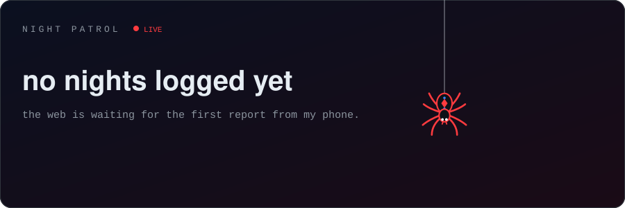
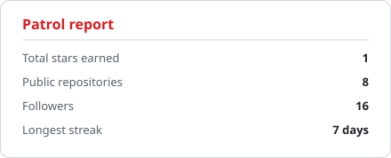
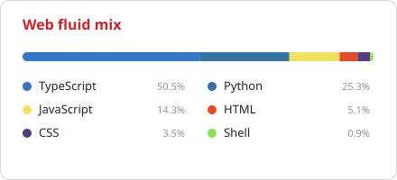
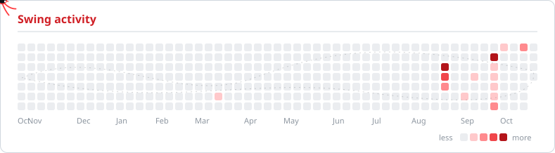

<div align="center">




<br/>


</div>



## 🕸️ Origin story

```console
$ cat /var/log/origin.log

[00:00:01]  bitten by a radioactive bug in production
[00:00:02]  wait. it's a feature.
[00:00:03]  acquired: wall-crawling, web-slinging, chronic 2am commits
[00:00:04]  responsibility level: great (see: power)
[00:00:05]  sleep: being tracked live below. it's not going well.
```


## 🕷️ Suit specs

| 🕸️ ability | ⚡ level |
|---|---|
| **Web-slinging** (APIs) | `██████████` 100% |
| **Wall-crawling** (frontend) | `█████████░` 90% |
| **Spidey sense** (debugging) | `████████░░` 80% |
| **Quips under pressure** | `██████████` 100% |
| **Sleep** | 👇 not a guess anymore, it's live |

## 🌙 Night patrol — live sleep tracker

<div align="center">



<sub>Logged automatically from my phone every morning. Each strand is a night; the longer it hangs, the more I slept.</sub>

</div>


## 🛠️ Web shooters

<div align="center">


</div>

## 🏙️ Missions

<table>
<tr>
<td width="50%" valign="top">

### 🐉 [DRACARYS](https://github.com/Aman-Thaper/dracarys)
**Mission:** hunt vulnerabilities and *prove* them.

An autonomous DAST scanner that crawls an authorized target, attacks it, and only reports what a deterministic oracle can prove: SQLi, XSS, IDOR, open redirects, leaked secrets. Then it writes the fix, rebuilds the target patched, and replays the original attack to confirm the hole is sealed.

[](https://pypi.org/project/dracarys-dast/)

`Python` `FastAPI` `GitHub Action` `VS Code` `MCP`

</td>
<td width="50%" valign="top">

### 🎟️ [ticket-mng](https://github.com/Aman-Thaper/ticket-mng)
**Mission:** survive the flash sale.

An event ticketing backend built for the hard parts: 10-minute seat holds with zero double booking under 200 concurrent requests, payments with webhooks and idempotency keys, live seat maps over WebSockets, and k6 load tests against 3 instances behind Nginx. Ships with zero-downtime deploys.

`TypeScript` `Fastify` `PostgreSQL` `Redis` `BullMQ` `Docker`

</td>
</tr>
</table>


## 📊 City watch

<div align="center">

<picture>
  <source media="(prefers-color-scheme: dark)" srcset="assets/stats-dark.svg" />
  
</picture>
<picture>
  <source media="(prefers-color-scheme: dark)" srcset="assets/languages-dark.svg" />
  
</picture>

<picture>
  <source media="(prefers-color-scheme: dark)" srcset="assets/web-dark.svg" />
  
</picture>

<sub>All cards above are drawn by <a href=".github/workflows/cards.yml">a workflow in this repo</a> every day. No outside service, so they never break.</sub>

</div>

## 📡 Signal in the sky

<div align="center">

[](https://github.com/Aman-Thaper)
[](https://www.linkedin.com/in/aman-thaper04)
[](mailto:work.aman04@gmail.com)

<br/>

*Got a bug that needs catching? Shine the signal.* 🕸️

</div>


